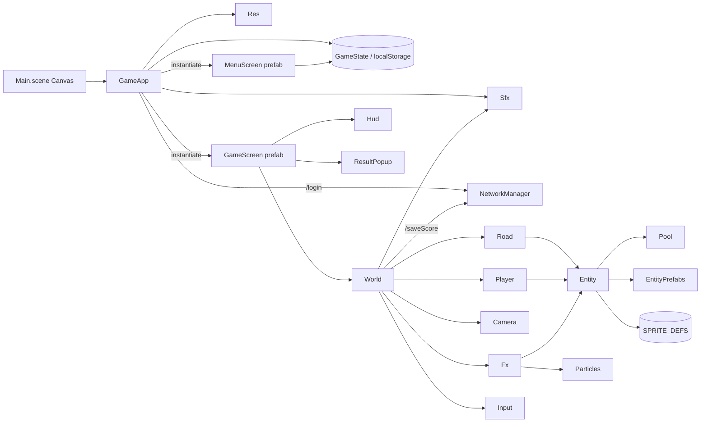
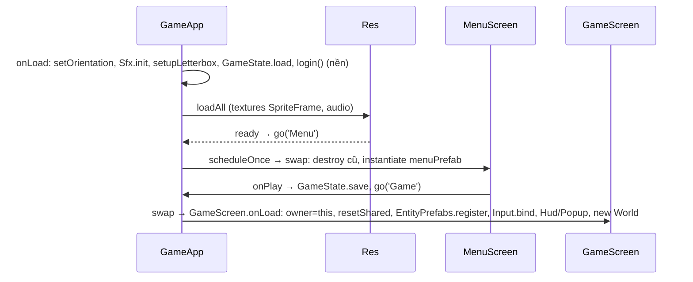

# BoatDriver — architecture

## Overview


## Flows

### Boot → Menu → Game


### Frame update (GAME_SPEC §6.2–§6.10)
```mermaid
sequenceDiagram
  participant G as GameScreen.update
  participant W as World
  G->>W: update(min(dt,1/30))
  W->>W: road.update (vpoint, waydots, buildings)
  W->>W: updatePlayer(readControls: Input keys | Hud touch)
  W->>W: updateScore / updateEnemy / spawnPickups / updateShield
  W->>W: checkCollisions (OverlapTracker: overtake, bags, shield icon; enemy, buoys, walls)
  W->>W: updateAudio, updateWater, cam.follow, fx.emitSpray/update, syncAndSort (z theo y)
  G->>W: cam.apply(worldRoot)
  G->>G: hud.refresh(cash, score, distance)
```

### Game over
```mermaid
sequenceDiagram
  participant W as World
  participant G as GameScreen
  participant P as ResultPopup
  W->>W: damage(): gameOn=LOST, reward=round(score/20), cash+=reward, save, POST /saveScore, hideTouch, Sfx crash
  W->>G: hooks.onDamage → scheduleOnce 3s
  G->>W: removePlayer(); result() (best=max, save)
  G->>P: show(score, cash, reward, best)
  P->>G: Menu → go('Menu') | Restart → go('Game')
```

## Data
| Thứ | Nơi | Ghi chú |
|---|---|---|
| Save dict | `core/Save.ts` key `Boat DriversaveData` | `Cash`, `Best`, `SelectedCar`, `Car<n>`=1 (owned; Car0 luôn có) |
| Boat stats/giá | `data/GameConfig.ts` | `BOAT_STATS[6]` {acceleration,maxSpeed,brake,turning}, `BOAT_PRICES` |
| Sprite defs | `data/SpriteDefs.ts` | `SPRITE_DEFS[def].frames[i]` {file,w,h,ox,oy,pts}; file = tên png trong resources/textures |
| Hằng toạ độ | `game/Entities.ts` VP_Y=288, KILL_Y=490; `game/Camera.ts` layout 1600×480; `game/Player.ts` WALL_L/R |
| World state | `game/World.ts` | `gameOn` (1 PLAYING / 0 LOST), `s` (speed), `powerUp` (2 = shield), score, distance |

## External
- HTTP portal qua `core/NetworkManager`: base `https://<url_api>/game-service/api-minigame`; `POST /login {token}` → `{username}`; `POST /saveScore {username, score, time}`. Query params URL (`token`, `url_api`) đọc bằng `urlParam()`, mọi body được gắn thêm PARAMS + `source` + `game_name`.
- Lưu local: `sys.localStorage`.
- Tooling: Funplay Cocos MCP (editor port 21458) qua `.mcp.json` / `.claude/tools/mcp.sh`.
